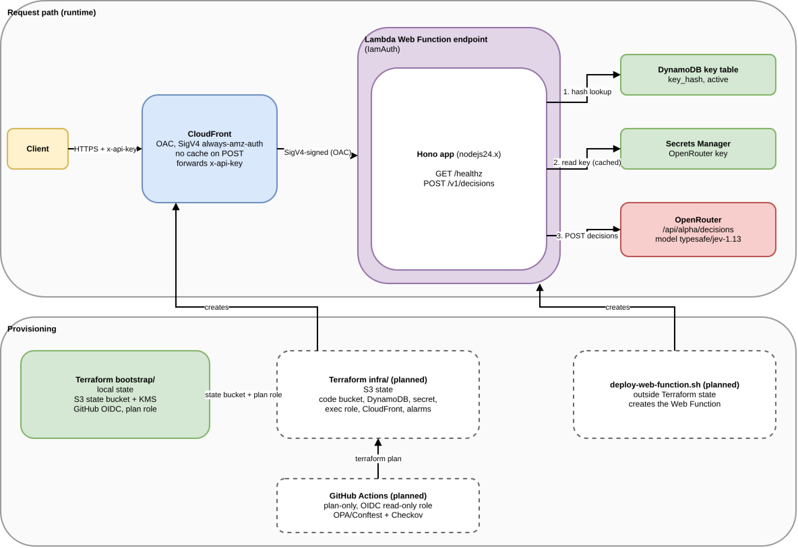

# jev-decision-api-lambda-web

A Hono API on AWS Lambda Web Functions that exposes Jev (TypeSafe System One) typed decisions through OpenRouter.

## Status

Early work in progress. Nothing here has been deployed.

Implemented in the repo today:
- `bootstrap/`: Terraform for the state bucket, KMS key, GitHub OIDC provider and read-only plan role. Validated only (`fmt`, `init -backend=false`, `validate`); not applied.
- `app/`: the Hono TypeScript app, tests (20 passing), zip packaging and an API-key minting script.
- `infra/backend.hcl.example`: backend config template.

Planned, not built yet:
- `infra/` stack (CloudFront/OAC, DynamoDB key table, secret container, execution role, alarms)
- Rego policies (OPA/Conftest) and Checkov gates
- `scripts/deploy-web-function.sh`
- CI workflows

Task list: `openspec/changes/jev-decision-api/tasks.md`.

## Architecture


*Rendered from docs/architecture.drawio — open in draw.io to edit.*

## API summary

- `GET /healthz`: 200 `{"status":"ok"}`, unauthenticated.
- `POST /v1/decisions`: header `x-api-key`, body `{state, questions}`, returns 200 `{answers}`.
- Question types: `noul`, `choice`, `score`.
- Errors: 400 invalid request, 401 unauthorized (identical for missing/unknown/revoked key), 413 body too large, 502 upstream error, 504 upstream timeout.
- Every response carries `x-request-id`. Details: `app/README.md`.

## Design decisions

- State: S3 with native locking (`use_lockfile`), no DynamoDB lock table. The bootstrap stack uses local state.
- The Web Function is deployed by a standalone script because the AWS provider has no resources for it yet. Tracking hashicorp/terraform-provider-aws issue 50429 and PR 50452.
- Two-stage apply: stage 1 base resources, run the deploy script, stage 2 CloudFront with `web_function_endpoint_host`.
- CI is plan-only: read-only OIDC role, `-lock=false`, never applies.
- Policy gates: OPA/Conftest Rego on the plan JSON is blocking; Checkov is non-blocking in v1.
- Fork PRs: `pull_request` trigger only, never `pull_request_target`.

Full rationale: `openspec/changes/jev-decision-api/design.md`.

## Repository layout

- `app/`: Hono service, tests, build/package/mint-key scripts
- `bootstrap/`: one-time Terraform (see `bootstrap/README.md`)
- `infra/`: currently only `backend.hcl.example`
- `openspec/`: change proposal, design, tasks and specs

## Local development (app)

Commands run on Node v22.22.2 (the package declares `>=24`, so npm prints an EBADENGINE warning; Lambda uses Node 24):

```sh
cd app && npm ci && npm run lint && npm run typecheck && npm test && npm run package
```

Observed output excerpts:

```
found 0 vulnerabilities
All matched files use Prettier code style!
 Test Files  4 passed (4)
      Tests  20 passed (20)
built dist/index.js
wrote dist/function.zip
```

More in `app/README.md`.

## Terraform bootstrap

See `bootstrap/README.md`. It has not been applied; applying it is a one-time manual step by the repo owner.

## Production checklist

- [ ] Apply `bootstrap/` locally
- [ ] Set repo secret `AWS_PLAN_ROLE_ARN`
- [ ] Build and apply `infra/` stage 1
- [ ] Set the OpenRouter key in Secrets Manager out of band (never in Terraform state)
- [ ] Mint API keys (`app/scripts/mint-api-key.mjs`) and store the hashes in DynamoDB
- [ ] Run the deploy script, then apply stage 2
- [ ] Verify repo settings: fork PRs do not receive write tokens, outside-contributor approval required
- [ ] Follow-up: per-key rate limiting and metering
- [ ] Optional: AWS WAF in front of CloudFront
- [ ] Swap in provider resources for the Web Function when released

## Known gaps

- The Web Function lives outside Terraform state until provider support lands, so drift is possible.
- The POST body is unsigned through CloudFront OAC (UNSIGNED-PAYLOAD); protected by TLS only.
- Context cap differs by source: TypeSafe docs say 64k per request, OpenRouter lists 262K. The request cap is set below this and is configurable.

## OpenSpec

Change artifacts live in `openspec/changes/jev-decision-api/`. Read in this order: `proposal.md` (why/what), `design.md` (architecture and decisions), `specs/` (requirements per capability: decision-api, api-key-auth, infrastructure, ci-policy), `tasks.md` (progress).

## License

Not yet specified.
